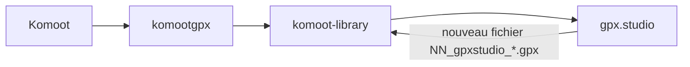

# GPX Komoot Studio — bibliothèque locale versionnée

Ce dépôt met en œuvre une **chaîne Komoot → fichiers GPX sur disque → édition dans [gpx.studio](https://gpx.studio)** (en ligne ou auto-hébergé), sans repasser par Wanderer. L’objectif est d’avoir une **arborescence claire** et des **versions traçables** (export Komoot, dérivés édités).

La vision détaillée et les alternatives d’outils sont dans [`komoot_gpx.studio_versions_119998e1.plan.md`](komoot_gpx.studio_versions_119998e1.plan.md).

## En bref



1. **Synchroniser** vos parcours Komoot vers des GPX locaux avec **KomootGPX** (`komootgpx` sur PyPI), outil communautaire basé sur des **endpoints non documentés** (voir [limites](#limites-et-risques)).
2. **Organiser** automatiquement les fichiers dans `komoot-library/tours/<id_komoot>/` et tenir un **`meta.json`** par parcours.
3. **Éditer** dans gpx.studio, puis **enregistrer** chaque version dérivée avec la commande `add-gpxstudio` (nouveau fichier + entrée dans `meta.json`).

---

## Installation

```bash
cd /chemin/vers/gpx-komoot-studio
python3 -m venv .venv
.venv/bin/pip install -r requirements.txt
```

Sur Linux, si `pip` refuse l’installation système (PEP 668), le **venv est obligatoire**.

---

## Structure des dossiers

```
komoot-library/
  .sync_incoming/          # téléchargements komootgpx (temporaire, gitignored)
  credentials.json         # session KomootGPX (gitignored — ne pas committer)
  tours/
    <komoot_tour_id>/      # ex. 12345678
      meta.json
      01_komoot_sync.gpx   # ou 01_komoot_planned / 02_komoot_recorded selon le mode
      NN_gpxstudio_YYYY-MM-DD.gpx   # versions éditées (NN = ordre global dans le dossier)
```

- **`--tour-type planned`** : fichier cible `01_komoot_planned.gpx`, rôle `planned`.
- **`--tour-type recorded`** : `02_komoot_recorded.gpx`, rôle `recorded`.
- **`--tour-type all`** (défaut) : `01_komoot_sync.gpx`, rôle `komoot_export`.

Variable optionnelle : **`KOMOOT_LIBRARY`** — chemin absolu vers la racine `komoot-library` si elle n’est pas à la racine du dépôt.

---

## Fichier `meta.json`

Chaque dossier `tours/<id>/` peut contenir un `meta.json` mis à jour par les scripts :

| Champ | Description |
|--------|-------------|
| `komoot_id` | Identifiant numérique Komoot |
| `title` | Titre lu dans le GPX si disponible |
| `url` | Lien `https://www.komoot.com/tour/<id>` |
| `last_sync` | Horodatage ISO (UTC) de la dernière sync Komoot |
| `source_tool` | Ex. `komootgpx` |
| `files` | Liste d’objets `{ "path", "role", "updated_at" }` — rôles typiques : `planned`, `recorded`, `komoot_export`, `edited_gpxstudio` |

---

## Script `scripts/komoot_library.py`

### `sync`

Lance `python -m komootgpx` avec le répertoire de travail **`komoot-library/`** (pour que `credentials.json` y soit créé), sortie dans `.sync_incoming/`, puis déplace les GPX vers `tours/<id>/` et met à jour `meta.json`.

Sans argument supplémentaire, le script passe par défaut **`-a -s`** à komootgpx (tous les parcours, ignorer les fichiers déjà présents dans la zone de sync). **`-I`** (noms de fichiers = id tour) est ajouté automatiquement s’il manque.

```bash
.venv/bin/python scripts/komoot_library.py sync
.venv/bin/python scripts/komoot_library.py sync --tour-type planned
.venv/bin/python scripts/komoot_library.py sync -- -a -s --start-date 2026-01-01
```

Identifiants : selon komootgpx (invite interactive, `-m`/`-p`, ou mécanisme documenté dans leur README — **ne jamais committer mots de passe**).

### `organize`

Si vous avez lancé **komootgpx à la main** vers `.sync_incoming/`, cette commande ne fait que **déplacer** les GPX reconnus vers `tours/<id>/` et mettre à jour les métadonnées.

```bash
.venv/bin/python scripts/komoot_library.py organize --tour-type all
```

### `add-gpxstudio`

Après export depuis gpx.studio, enregistre une **nouvelle version** (copie + entrée dans `meta.json`). Le nom est `NN_gpxstudio_YYYY-MM-DD.gpx` avec `NN` = prochain index disponible parmi tous les `NN_*.gpx` du dossier.

```bash
.venv/bin/python scripts/komoot_library.py add-gpxstudio --tour-id 12345678 --source ~/Downloads/ma_route.gpx
.venv/bin/python scripts/komoot_library.py add-gpxstudio --tour-id 12345678 --source ./edit.gpx --date 2026-04-15
```

---

## Limites et risques

- **Pas d’API officielle de sync** côté Komoot pour un export automatisé de masse ; les outils tiers peuvent **casser** si Komoot change son API. Prévoir des **exports de secours** (takeout, ZIP, copie régulière de `komoot-library/`).
- **Komoot ← gpx.studio** : pas de synchronisation inverse automatique « comme Git ». Le flux habituel est un **réimport manuel** d’un GPX dans Komoot quand vous voulez mettre à jour un itinéraire ([aide Komoot](https://support.komoot.com/hc/en-us/articles/360022834132-Export-and-import-GPS-files)).
- **`credentials.json`** : fichier sensible, déjà listé dans `.gitignore`.

---

## Ce qui est déjà en place

- Choix d’un outil de sync : **KomootGPX** intégré au script `sync`.
- Convention de dossiers `komoot-library/tours/<id>/` + `meta.json` + nommage Komoot / gpx.studio.
- Environnement Python décrit dans `requirements.txt` et `.gitignore` adapté.

---

## Ce qu’il reste à faire / questions en suspens

| Sujet | Détail |
|--------|--------|
| **gpx.studio : hébergement** | Utiliser **gpx.studio en ligne** uniquement, ou **build statique + nginx/Caddy** sur une machine locale (ex. Raspberry Pi) pour la confidentialité et des URLs stables vers les GPX ? |
| **Accès aux fichiers pour gpx.studio** | Édition par **glisser-déposer** depuis l’explorateur de fichiers, ou **serveur HTTP** local pointant vers `komoot-library/` (voire paramètre `?files=[...]` si même origine) ? |
| **Alternative à KomootGPX** | Le plan mentionne **export-komoot** (Go), **routesmith**, **komoot-takeout** : à comparer si vous avez besoin d’autres filtres, du FIT, ou d’un comportement différent. |
| **Images Komoot** | komootgpx peut télécharger des dossiers `*_images` ; le script actuel se concentre sur les **GPX** — décider si vous rangez aussi les images sous `tours/<id>/`. |
| **Git / sauvegardes** | Initialiser un dépôt sur `komoot-library/`, tags sur versions stables, **Git LFS** si les GPX deviennent très lourds ; sauvegardes hors machine (NAS, cloud chiffré). |
| **Évolution du script** | Liste des versions, détection de doublons, validation GPX : possible plus tard en Python sans changer la convention de dossiers. |
| **Maintenance** | Après toute mise à jour Komoot, **retester** komootgpx ; surveiller les issues du projet [KomootGPX](https://github.com/timschneeb/KomootGPX). |

---

## Fichiers utiles

| Fichier | Rôle |
|---------|------|
| [`komoot_gpx.studio_versions_119998e1.plan.md`](komoot_gpx.studio_versions_119998e1.plan.md) | Plan d’origine (contexte, alternatives, ce que le flux ne fait pas). |
| [`scripts/komoot_library.py`](scripts/komoot_library.py) | Implémentation ; aide intégrée : `python scripts/komoot_library.py -h` et `… sync -h`, etc. |
| [`requirements.txt`](requirements.txt) | Dépendance `komootgpx`. |
