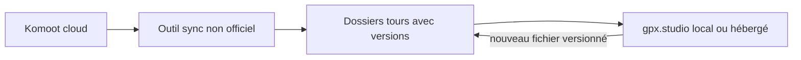

# Plan : Komoot + gpx.studio + versions locales

## Contexte

Vous avez constaté que **réimporter dans Wanderer crée un nouveau tracé** : vous abandonnez Wanderer pour **Komoot** (source des parcours) + **gpx.studio** (édition). Il manque une **couche locale** : synchroniser Komoot vers le disque et **nommer / versionner** clairement chaque état (itinéraire Komoot, trace perso enregistrée sur Komoot, fichier retouché dans gpx.studio, etc.).

## Komoot : pas d’API officielle « sync »

Komoot permet l’export **manuel** de parcours (voir [aide Komoot export/import](https://support.komoot.com/hc/en-us/articles/360022834132-Export-and-import-GPS-files)). Pour un **téléchargement en masse et automatisé**, la communauté s’appuie sur des **endpoints non documentés** ; ces outils peuvent **casser** si Komoot change son API — à intégrer dans votre plan de maintenance.

**Outils représentatifs** (à comparer selon vos besoins : langage, incrémental, filtres) :

| Outil | Langage | Idée |
|-------|---------|------|
| [timschneeb/KomootGPX](https://github.com/timschneeb/KomootGPX) | Python (`pip install komootgpx`) | Téléchargement en masse, filtres (dates, type, etc.), option type `--skip-existing` pour un comportement proche d’une synchro |
| [pieterclaerhout/export-komoot](https://github.com/pieterclaerhout/export-komoot) | Go | Export incrémental par défaut, GPX/FIT |
| [edgard/routesmith](https://github.com/edgard/routesmith) | Python | Bulk + enrichissements (OSM, dédup, etc.) — plus lourd |
| [nevvkid/komoot-takeout](https://github.com/nevvkid/komoot-takeout) | Python | Orientation « takeout » / export |

**Choix pragmatique** : commencer par **KomootGPX** ou **export-komoot** si vous voulez surtout **un dossier à jour** avec peu de code maison ; lire leur README pour l’authentification (souvent email/mot de passe ou cookie — **ne jamais** committer de secrets).

## Schéma de dossiers pour les versions (cœur du « gestionnaire de versions »)

Sans base de données dédiée, le plus simple et robuste est une **convention de dossiers** + éventuellement **Git** pour l’historique.

Exemple pour un parcours Komoot identifié par `tour_id` (ou slug lisible) :

```text
komoot-library/
  tours/
    <komoot_tour_id>/
      meta.json              # id Komoot, nom, URL, dates de sync
      01_komoot_planned.gpx  # si vous exportez le tracé « planifié »
      02_komoot_recorded.gpx # trace enregistrée / activité (si différente)
      03_gpxstudio_2026-04-12.gpx   # dérivé édité (date dans le nom)
      03_gpxstudio_2026-04-12_notes.txt  # optionnel
```

- **`meta.json`** : `komoot_id`, `title`, `url`, `last_sync`, `source_tool`, liste des `files` avec un rôle (`planned` | `recorded` | `edited_gpxstudio`).
- **Préfixe numérique** ou **timestamp** : ordre chronologique / sémantique clair.
- **Éditions gpx.studio** : toujours **nouveau fichier** (`04_...`, ou un suffixe date) plutôt qu’écraser `02_`, pour garder l’historique sans ambiguïté.

**Git (optionnel mais puissant)** : initialiser un dépôt sur `komoot-library/` ; les GPX sont du texte → **diffs** et **tags** (`v2026-04-12-komoot-sync`, `after-gpxstudio-edit`). Pour de très gros fichiers, envisager **Git LFS** si besoin.

## gpx.studio : auto-hébergé « si ça aide »

- **Utile** : même machine que les fichiers (LAN), pas de dépendance au cloud ; vous ouvrez le GPX par **glisser-déposer** ou, si vous servez le dossier en **HTTP** local (nginx/Caddy), via un lien du type `?files=["http://rpi5.local/library/.../03_....gpx"]` (même origine si tout est sous le même hôte).
- **Pas obligatoire** : éditer des fichiers **locaux** sur le PC avec gpx.studio en ligne fonctionne aussi ; l’auto-hébergement aide surtout la **privacy** et les **URLs** pour recharger les mêmes fichiers.

Le détail build Docker/nginx pour gpx.studio reste valable tel quel (build statique SvelteKit + nginx), sans Wanderer devant.

## Petit « outil » maison minimal

Vous n’avez pas besoin d’une grosse appli au départ :

1. **Script** (bash ou Python) qui appelle l’outil de sync choisi vers `tours/<id>/` et met à jour `meta.json`.
2. **Règle** : après édition gpx.studio, **Enregistrer sous** un nouveau nom `NN_gpxstudio_YYYY-MM-DD.gpx` dans le même dossier et une ligne dans `meta.json` (peut être fait à la main au début).

Évolution possible plus tard : script Python qui lit `meta.json`, vérifie les doublons et liste les versions.

## Ce que ce plan ne fait pas

- **Synchronisation inverse** Komoot ← gpx.studio : Komoot ne propose pas un flux générique « import de toute votre bibliothèque modifiée » comme une base Git ; l’usage habituel est **réimport manuel** d’un GPX dans Komoot quand vous voulez mettre à jour un itinéraire — à traiter au cas par cas (selon [aide import Komoot](https://support.komoot.com/hc/en-us/articles/360022834132-Export-and-import-GPS-files)).
- **Garantie à long terme** des outils non officiels : prévoir des **exports de secours** (ZIP Komoot, ou copie régulière de `komoot-library/`).

## Synthèse



**En une phrase** : synchroniser Komoot vers une **arborescence versionnée** (fichiers + `meta.json` ± Git), éditer dans gpx.studio en **ajoutant** des fichiers dérivés nommés, sans vous fier à Wanderer pour les doublons.
